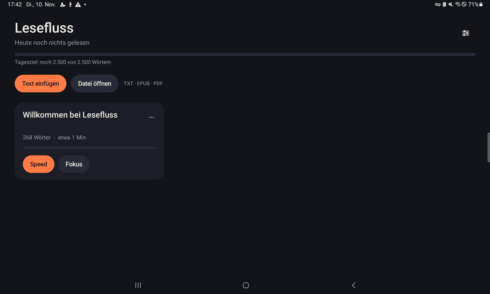
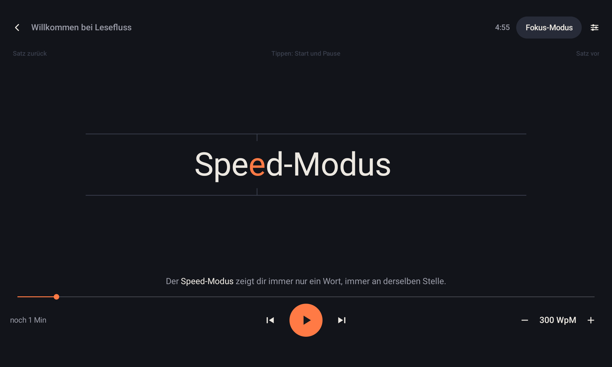
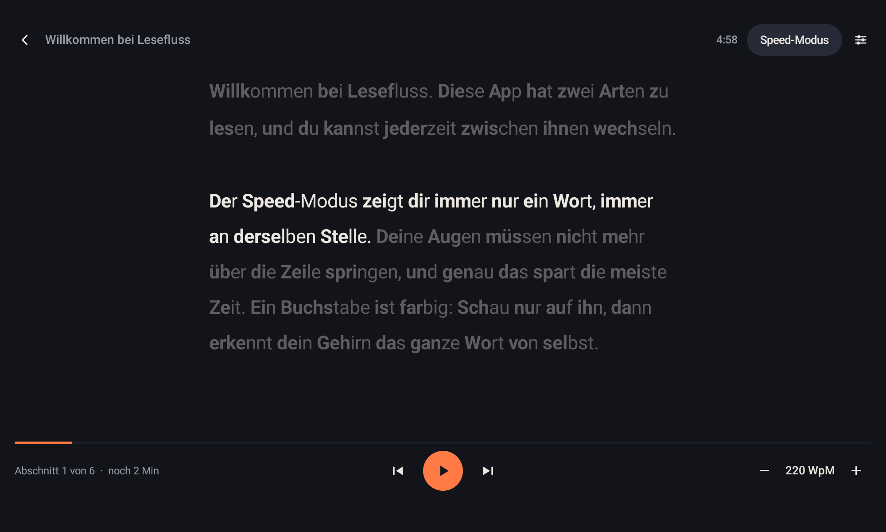

# Lesefluss

A speed reading app for Android tablets, with a calm focus mode for days when concentration is short (made with ADHD in mind).
The app is in German.

| Library | Speed mode | Focus mode |
|---|---|---|
|  |  |  |

## Features

- **Speed mode (RSVP):** one word at a time at a fixed spot, with a colored focus letter (optimal recognition point).
  Short pauses after commas and full stops, longer words stay a bit longer, soft start, 1 to 3 words at once.
  Tap the middle to start and pause, the left or right side to jump a sentence back or forward.
- **Focus mode:** only a small block of text on screen, the active sentence bright and the rest faded,
  bold word beginnings as anchors for the eyes, and an optional pointer that moves through the words at your pace.
- **Sprints and daily goal:** short reading sprints (for example 5 minutes), words read today and days in a row.
- **Own texts:** paste text, open TXT, EPUB or PDF files, or share text from another app. The reading position is saved.
- **Settings:** 4 color themes, 6 accent colors, 5 fonts, speed, sizes, pauses, line spacing, block length and more.

Everything stays on the device. The app has no internet permission.

## Install

**Web version:** open https://erdinco467.github.io/lesefluss/ in any browser (works offline, can be installed as an app). Texts stay in your browser.

**Android:** 
Download `lesefluss.apk` from the [latest release](../../releases/latest) and open it on the tablet
(allow installing apps from unknown sources once).

## Build

Kotlin, no Android Studio needed, no layout files (the whole UI is built in code).

```bash
./gradlew assembleDebug
```

Needs JDK 17 and the Android SDK (platform 34), for example
`JAVA_HOME=/opt/homebrew/opt/openjdk@17` and `ANDROID_HOME=/opt/homebrew/share/android-commandlinetools`.
`local.properties` with `sdk.dir=...` is created by you and not committed.

## Made by

erdinco467, a hobby developer from Germany. Most of the code was written by [Claude Code](https://code.claude.com);
the idea, the design decisions and the testing on the tablet are mine.

## License

MIT, see `LICENSE`. PDF reading uses [pdfbox-android](https://github.com/TomRoush/PdfBox-Android) (Apache 2.0).
